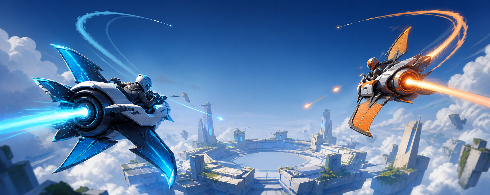

# Aeronauts 2



> Original concept art for the project. The current playable uses deliberately simple greybox visuals.

[](https://unity.com/releases/editor/whats-new/6000.0.81f1)
[](LICENSE)
[](#project-status)

**Aeronauts 2** is an experimental competitive aerial arena shooter built around expressive movement and precision combat. The goal is the mechanical depth of a vehicle-sports game combined with the readable aim, positioning, and clutch moments of a competitive shooter.

The current browser-first prototype is an offline first-to-five duel against a flight bot. Player and bot use the same fixed-tick flight, projectile, shield, hull, hit-region, elimination, and respawn rules.

## Highlights

- Fixed 60 Hz flight simulation with body and velocity alignment by construction
- Full stop and rotate-in-place control, with movement resuming along body forward
- Independent mouse/right-stick aim with a centered reticle
- Toggleable Aim View and body-aligned Forward View
- Manual roll, double-tap automatic 360° rolls, airbrake hook turns, boost, and timed slingshot exits
- Zero-spread finite-speed primary projectiles that reward leading targets
- Instant three-shot railgun with lethal cockpit precision
- Non-regenerating shields, body/cockpit damage regions, and three-second respawns
- First-to-five duel against a bot driven through the shared flight simulation
- Keyboard/mouse and gamepad support from the same device-neutral input layer
- WebGL and Windows targets in one Unity project

## Project status

This is an early gameplay prototype, not a finished game. It currently includes:

- a generated greybox Flight Lab arena;
- a playable player-versus-bot duel;
- three stationary/moving combat drill targets;
- live flight, combat, health, bot, and match diagnostics;
- 30 EditMode and 7 PlayMode tests;
- an automated real-Chrome WebGL smoke test.

The latest local WebGL verification ran at 59.9 FPS with no gameplay, page, network, or runtime errors. Multiplayer, final art, audio, matchmaking, progression, and Steam integration are intentionally deferred until the flight and combat loop feels right.

## Controls

| Action | Keyboard and mouse | Gamepad |
| --- | --- | --- |
| Aim | Mouse | Right stick |
| Pitch / yaw | `W` `S` / `A` `D` | Left stick |
| Manual roll | Hold `Q` / `E` | Hold bumpers |
| Automatic 360° roll | Double-tap `Q` / `E` | Double-tap a bumper |
| Accelerate | `Space` | South face button |
| Airbrake | `Left Ctrl` | West face button |
| Boost | `Left Shift` | East face button |
| Primary projectile | Left mouse | Right trigger |
| Railgun | Right mouse | Left trigger |
| Toggle Aim / Forward View | `C` | Right-stick press |
| Compare constrained / full-360 aim | `V` | Select / Back |
| Reset duel | `R` | — |

See [docs/controls.md](docs/controls.md) for the complete movement, camera, weapon, and damage model.

## Combat rules

- Every combatant starts with `300` shield and `100` hull.
- Shield never regenerates.
- While shield remains, hit location does not alter damage and shield-breaking damage does not spill into hull.
- The primary travels at `120` units/second and deals `16` damage. An unshielded cockpit hit deals lethal hull damage.
- The railgun is instantaneous, has three shots, and deals `80` body/shield damage.
- A railgun cockpit hit bypasses shield and eliminates immediately.
- Weapons fire from the shared head/cockpit origin, so third-person camera peeking cannot shoot through cover.

These are playtest values stored in Unity data assets, not final balance decisions.

## Getting started

### Requirements

- Unity `6000.0.81f1` with Universal Render Pipeline support
- Web Build Support only if you want to build the browser version
- Git LFS for future large source assets

Clone the repository and open it with the exact editor version:

```powershell
git clone https://github.com/abobabo91/aeronauts-2.git
cd aeronauts-2
```

Open `Assets/Aeronauts2/Scenes/FlightLab/FlightLab.unity` and press Play.

The project intentionally remains on Unity 6.0 LTS because a tested Unity 6.3 editor/URP combination failed before project code compiled. See [docs/development.md](docs/development.md) before changing editor or package versions.

## Tests

From PowerShell on Windows:

```powershell
$unity = "$env:LOCALAPPDATA\Programs\Unity\Hub\Editor\6000.0.81f1\Editor\Unity.exe"

& $unity -batchmode -nographics -projectPath . `
  -runTests -testPlatform EditMode `
  -testResults .\Logs\editmode-results.xml `
  -logFile .\Logs\editmode-tests.log

& $unity -batchmode -nographics -projectPath . `
  -runTests -testPlatform PlayMode `
  -testResults .\Logs\playmode-results.xml `
  -logFile .\Logs\playmode-tests.log
```

The tests cover fixed-tick movement, airbrake/boost timing, roll gestures, aim constraints, weapon cadence, damage gating, critical hits, head-origin obstruction, bot flight/fire, first-to-five scoring, scene structure, and device bindings.

## WebGL build

```powershell
$unity = "$env:LOCALAPPDATA\Programs\Unity\Hub\Editor\6000.0.81f1\Editor\Unity.exe"

& $unity -batchmode -quit -nographics -projectPath . `
  -executeMethod Aeronauts2.Editor.Build.BuildPipeline.BuildWebGL `
  -logFile .\Logs\webgl-build.log

python .\tools\serve_webgl.py --directory .\Build\WebGL --port 8008
```

The custom server supplies the Brotli and WebAssembly headers Unity requires. Build output is written to ignored `Build/WebGL`.

## Architecture

Core gameplay is separated from presentation so the same rules can later support WebGL, native builds, bots, replays, and server authority:

1. device input becomes movement, aim, maneuver, and fire intent;
2. fixed-tick simulation owns flight, weapon, and damage state;
3. camera and presentation read state without owning movement;
4. UI reads public state and sends commands;
5. a future networking layer will serialize intent/state at those boundaries.

Read the detailed [architecture](docs/architecture.md), [demo scope](docs/demo-scope.md), and [development guide](docs/development.md).

## Roadmap

- Tune flight, aiming, bot pressure, time-to-kill, and railgun economy through playtests
- Add stronger duel flow, arena boundaries, spawn presentation, and combat readability
- Replace greybox silhouettes with original pilot-rig and compact-aircraft presentations sharing one gameplay frame
- Validate mouse/controller competitive balance
- Add browser-compatible authoritative multiplayer only after the offline vertical slice is stable
- Build toward a native Windows/Steam release from the same Unity project

## Contributing

The design is still moving quickly. Bug reports and focused gameplay feedback are welcome through GitHub Issues. Please discuss large features before implementing them so they do not lock in networking, art, or balance assumptions prematurely.

## License

The project source is available under the [MIT License](LICENSE).

`Aeronauts 2` is a working title for an original project. It is not affiliated with the 1999 PlayStation game *Aironauts*. No assets, characters, branding, audio, code, or other content from that game are included or permitted here.
